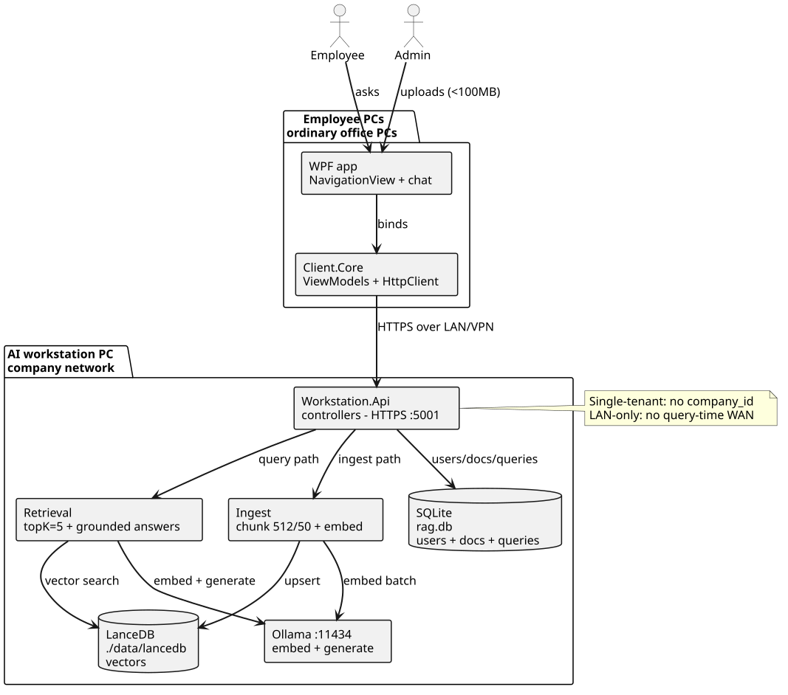
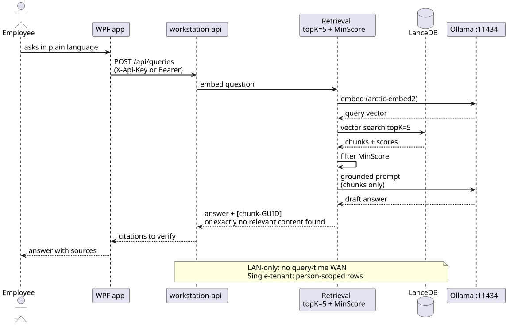
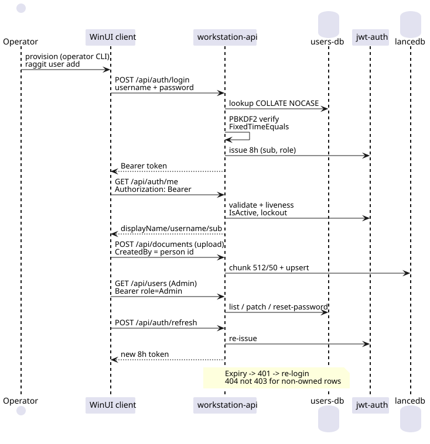

# RAGGit

A private, on-premises retrieval-augmented generation (RAG) system: it turns a
company's documents into a searchable library people can ask questions of in
plain language — every answer shows the passages it came from.

Everything runs on hardware you control. Documents never leave your network,
and answers are grounded in cited passages instead of being guessed.

## Features

- **Private by design** — runs on your own hardware or your own private cloud;
  no third-party AI service and no query-time internet.
- **Single-tenant** — one installation serves one company; no cross-company sharing.
- **Grounded answers** — every answer cites its source chunks, or returns
  exactly "no relevant content found" instead of hallucinating.
- **Per-user access** — admins manage documents and accounts; employees search
  and ask, and only ever see what they are allowed to see.

## How it works

An **AI workstation** — a capable machine on your network running
[Ollama](https://ollama.com) — stores documents, builds the vector index, and
answers queries. **Ordinary Windows PCs** run the desktop client, which talks
to the workstation over the LAN or VPN.


*System topology: the WPF desktop client talks to one workstation over the
LAN/VPN; documents, accounts, and answers stay on that machine.*


*What happens on a query: the workstation retrieves the relevant passages and
answers with named sources — or says nothing relevant exists instead of
guessing.*


*How people get in: an operator creates accounts, staff sign in for 8-hour
sessions, admins manage access.*

## Running it (developers)

Requirements: **.NET 10** (pinned by `global.json`) and
[Ollama](https://ollama.com) for the AI part.

```powershell
git clone https://github.com/daskas-welt/raggit.git
cd raggit
dotnet build RAGGit.sln -c Release -p:Platform=x64
ollama pull snowflake-arctic-embed2
ollama pull qwen2.5:3b
dotnet run --project src/RAGGit.Workstation.Api --urls https://localhost:5001
```

The API listens on `https://localhost:5001` by default. Building the full
solution needs Windows (it includes the WPF client); without the client, build
the server filter instead: `dotnet build RAGGit.Server.slnf -c Release`.

Create a login with the operator CLI. Run it from the API project, since the
database path is relative to the working directory:

```powershell
cd src/RAGGit.Workstation.Api
dotnet run -- user add --username me --display-name "Me" --role Admin --password "Passw0rd!"
```

The desktop client (`src/RAGGit.Client.WPF`) needs both `Workstation:Url` and
`Workstation:ApiKey` in its `appsettings.json` before it will connect.

Run the tests with:

```powershell
dotnet test tests/unit/RAGGit.Tests.Unit.csproj -c Release
dotnet test tests/contract/RAGGit.Tests.Contract.csproj -c Release
dotnet test tests/integration/RAGGit.Tests.Integration.csproj -c Release
```

`RequiresOllama` tests are skipped automatically when Ollama is not running, so
the suite stays green offline.

## Installing the app (end users)

The desktop client is built and distributed **per deployment by each company's
IT**, because the app is only useful against a running workstation — it needs
that workstation's URL and key to connect.

IT builds a self-contained package and gives employees a link. Employees
double-click it, sign in with the credentials IT created, and use the app. To
build that package (Windows; the result needs no .NET runtime on the employee's
PC):

```powershell
dotnet publish src/RAGGit.Client.WPF -c Release -r win-x64 --self-contained true `
  -p:Platform=x64 -p:PublishSingleFile=true -o ./out/client
```

Ship `appsettings.json` next to the executable — it carries the deployment's URL
and key, so it is per-deployment and must never be committed — plus the
workstation's `raggit.crt` for the employee to trust. There is **no
auto-update**: shipping a fix means rebuilding and redistributing the package.
See [docs/runbooks/client-install.md](docs/runbooks/client-install.md) for the
step-by-step install.

## Deploying the workstation

The workstation supports two modes, both selected by configuration only — the
desktop client always runs locally and talks to the workstation over your
network:

- **Local (default)** — the workstation runs on a machine on your network.
- **Private cloud** — it runs on a company-controlled cloud VM reachable only
  from your own network (VPN or restricted source addresses). It is never an
  open public endpoint.

```bash
cp deploy/.env.example deploy/.env   # WORKSTATION_HOST, BIND_ADDRESS, RAGGIT_DATA_DIR, keys, certificate
sudo ./deploy/bootstrap.sh           # Linux host: Docker + Ollama, TLS, models, first admin account
```

See [`docs/runbooks/workstation-deployment.md`](docs/runbooks/workstation-deployment.md)
for the full operator runbook — provisioning, TLS, network boundary, verification,
snapshot/restore, and teardown — and `deploy/` for the stack, the bootstrap
script, and the client configuration template.

## Project structure

- `deploy/` — production compose stack, bootstrap script, client config template
- `src/RAGGit.Workstation.Api` — the workstation web service
- `src/RAGGit.Client.WPF` — the Windows desktop client (WPF + WPF-UI)
- `src/RAGGit.Client.Core` — shared client logic (view models, API clients)
- `src/RAGGit.Core` — shared domain types
- `src/RAGGit.Ingest` — document ingestion and chunking
- `src/RAGGit.Retrieval` — vector search and grounded prompt assembly
- `tests/` — unit, contract, and integration tests
- `docs/` — PlantUML diagram sources, rendered SVGs, and operator runbooks

## Security

- **Single-tenant** — one workstation serves exactly one company. There is no
  `company_id`, no shared tenancy, and no cross-company data flow.
- **Secrets stay out of source** — API keys, model paths, and certificates come
  from `dotnet user-secrets` (development), environment variables (production),
  or a company secret manager. `appsettings.json` ships only empty placeholders.
- **Data stays local** — the SQLite database and vector index live under
  `./data/`, and model weights under `./models/`. Both are gitignored and never
  committed.

To report a security issue, contact the project owner directly rather than
opening a public issue.

## License

[MIT](LICENSE) © 2026 Andreas Daskalopoulos. AI models stay on customer-owned
workstations and are never redistributed by this project.
